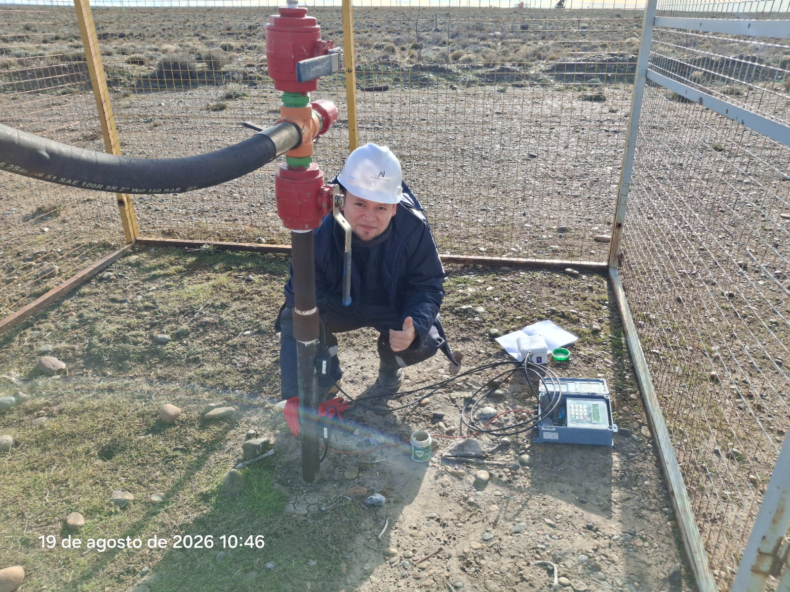
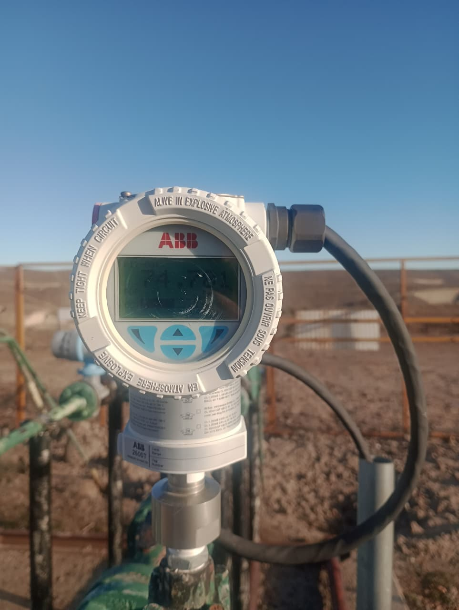
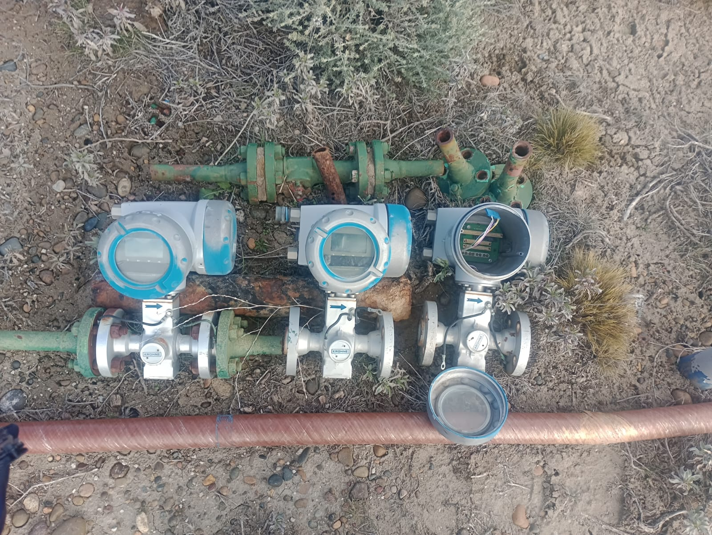
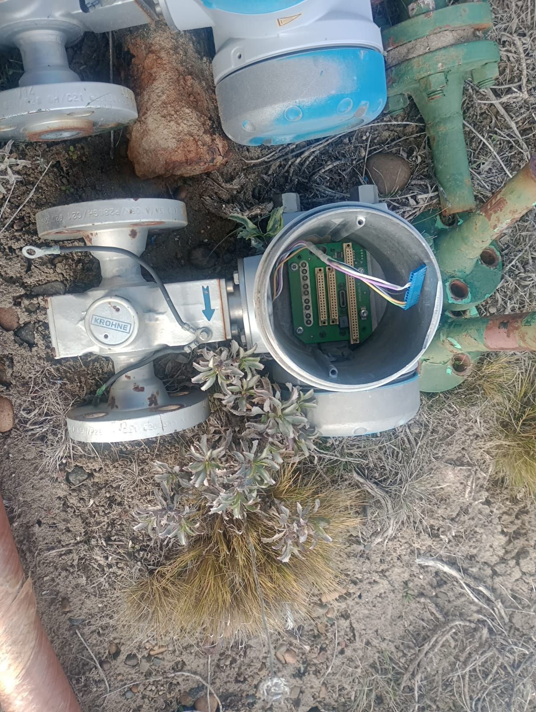

# Relevamiento e instrumentación en yacimiento petrolero

Experiencia de campo para Aconcagua Ingeniería: relevamiento de mediciones e instrumentación electrónica en instalaciones de un yacimiento petrolero.

**Edimerk Adrian Torres** · [LinkedIn](https://www.linkedin.com/in/edimerktorres/)

## Objetivo y aporte personal

Realicé relevamientos de mediciones de campo e instrumentación electrónica en un yacimiento petrolero, en el marco de mi trabajo para Aconcagua Ingeniería. La experiencia combina trabajo en instalaciones de producción, observación de equipos de medición y documentación técnica.

## Trabajo desarrollado

- Relevamiento de variables de operación y equipos de instrumentación.
- Medición de caudal y temperatura en pozos inyectores, según la experiencia profesional previamente documentada.
- Registro de condiciones de componentes e instrumentos para la elaboración de documentación de campo.

Las fotografías muestran el entorno de trabajo, el montaje de medición y equipos de instrumentación. Se presentan como evidencia de experiencia profesional; no como diseño propio de los instrumentos comerciales ni como certificación de calibración. No se publican informes operativos ni valores internos del cliente.

## Galería de experiencia

### Mediciones en campo

### Instrumentación instalada

### Equipos de medición de caudal

### Detalle de electrónica de instrumentación

## Competencias

Instrumentación industrial · Medición de campo · Caudal · Documentación técnica
