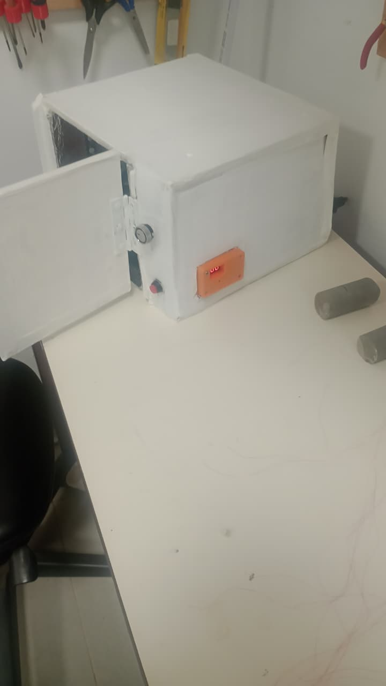
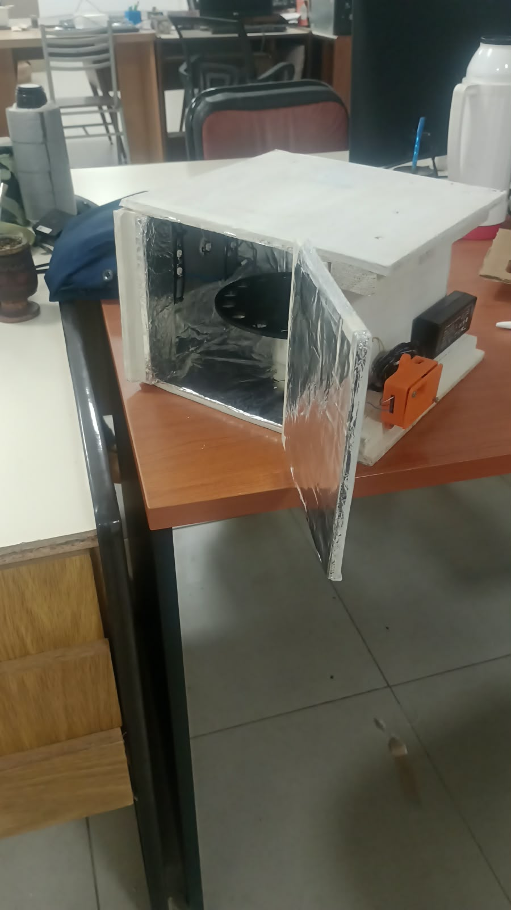
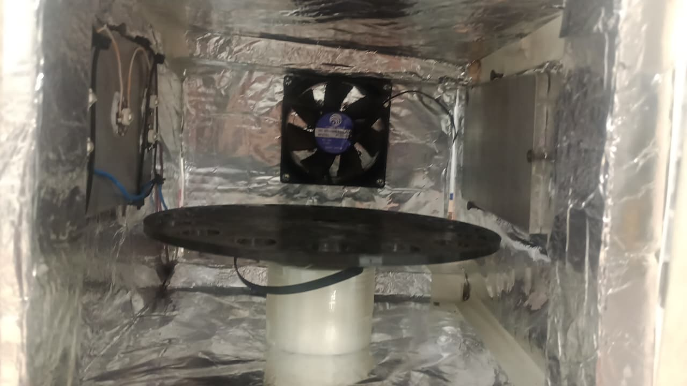
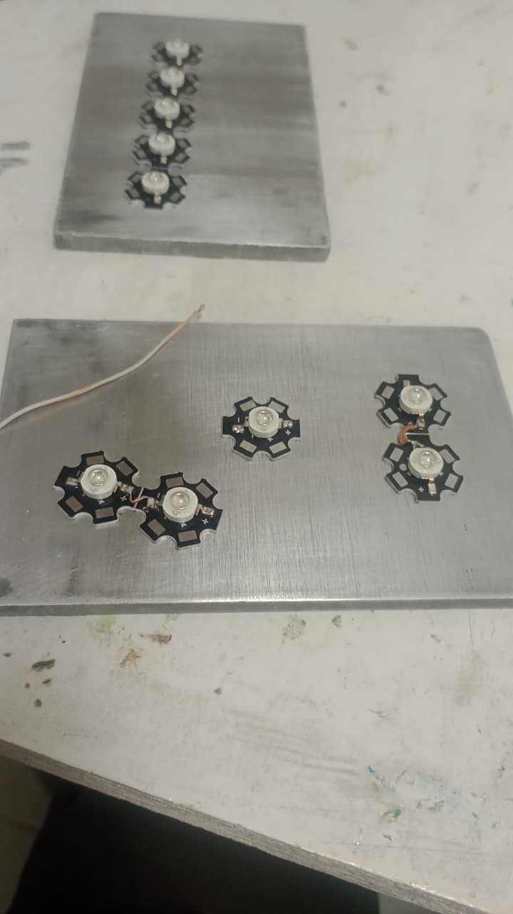
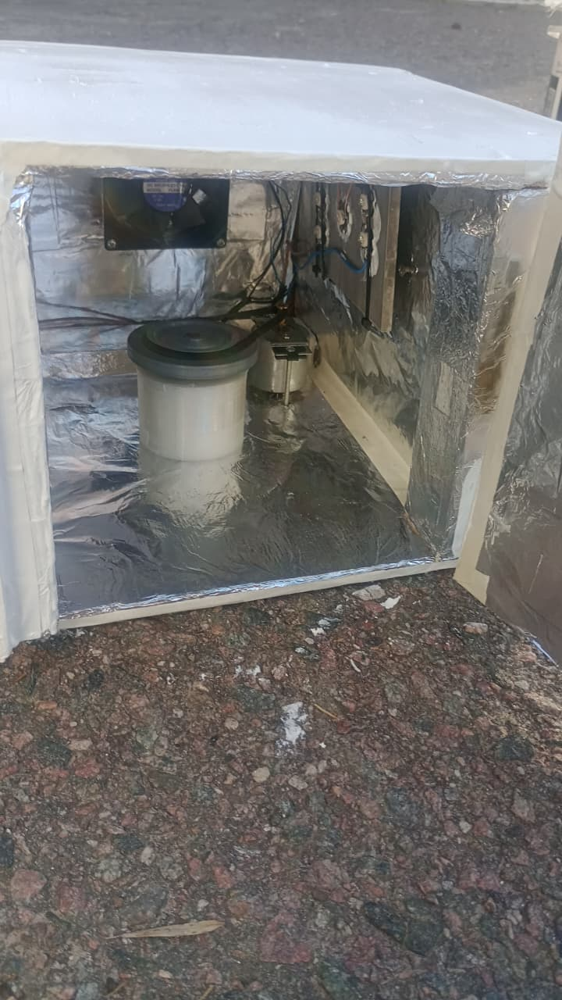
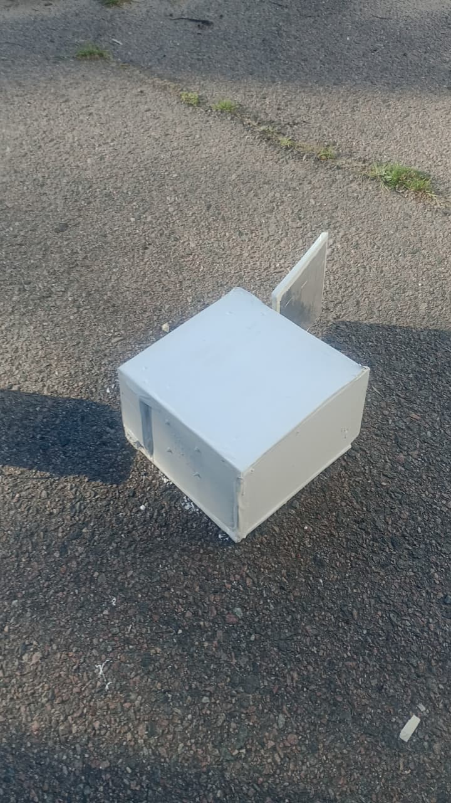
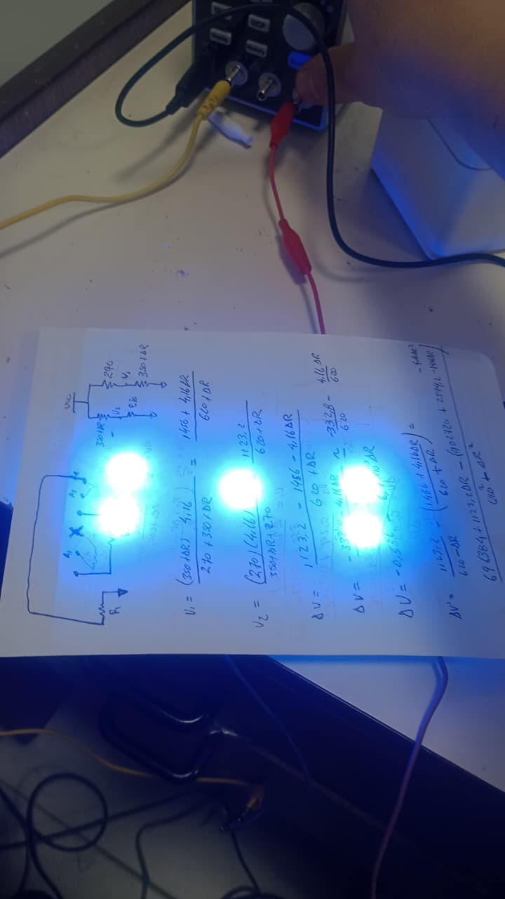

# Cabina UV para curado de muestras de roca

Desarrollo integral de una cabina de irradiación UV destinada al curado de muestras de roca. El trabajo abarcó diseño, construcción física, integración electrónica y puesta en funcionamiento.

**Autor: Edimerk Adrian Torres** · [LinkedIn](https://www.linkedin.com/in/edimerktorres/)

## Objetivo y aporte personal

La cabina se construyó para el curado de muestras de roca mediante irradiación UV. Realicé el diseño, la construcción física y la electrónica del equipo.

## Desarrollo

- Construcción y terminación del gabinete.
- Montaje de LED UV sobre placas de soporte.
- Integración de un motor y del conjunto interno.
- Trabajo de electrónica y pruebas documentadas mediante fotografías.

Las imágenes muestran las etapas de construcción y el equipo terminado. No se afirma una longitud de onda, irradiancia, dosis ni tiempo de curado universal: esos parámetros deben documentarse con las especificaciones de los componentes y el protocolo de ensayo. El material constituye un caso de desarrollo de equipo, no un procedimiento de operación UV ni una certificación de sus protecciones.

## Galería del proyecto

### Equipo terminado

### Construcción del gabinete

### Montaje interno

### Montaje de LED UV

### Integración del motor

### Etapa de terminación

### Cálculos y prueba de electrónica

## Videos

Videos originales del proyecto, disponibles para abrir o descargar:

- [Video 1](demostracion-1.mp4)
- [Video 2](demostracion-2.mp4)

## Tecnologías y habilidades

Integración electrónica · LED UV · Construcción de equipos de laboratorio
