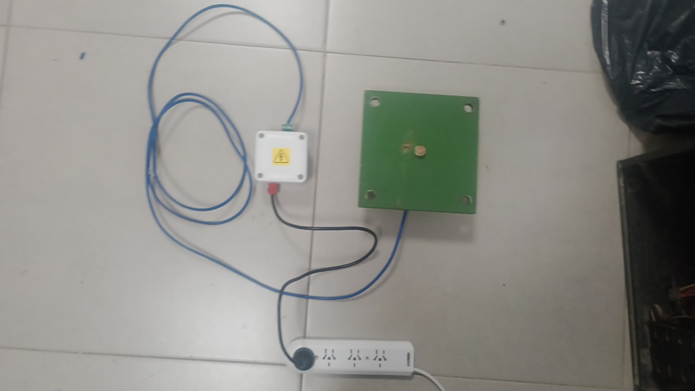
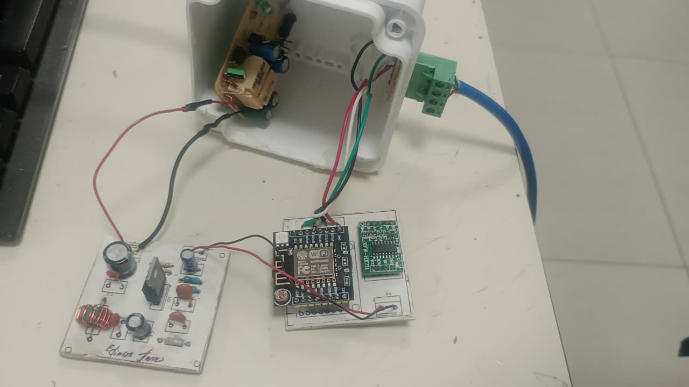
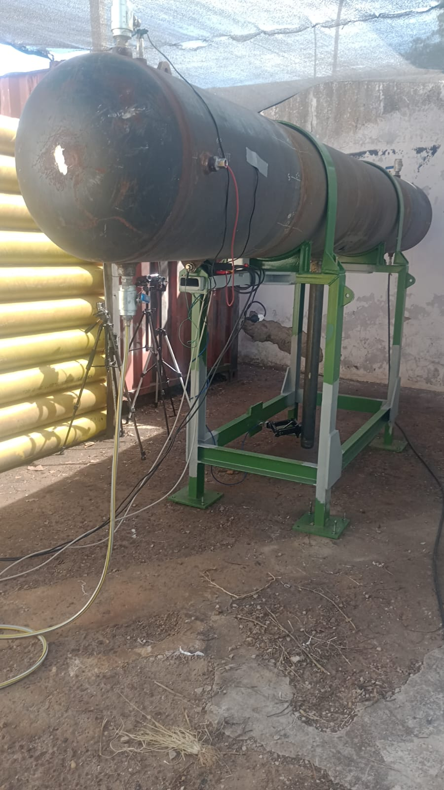
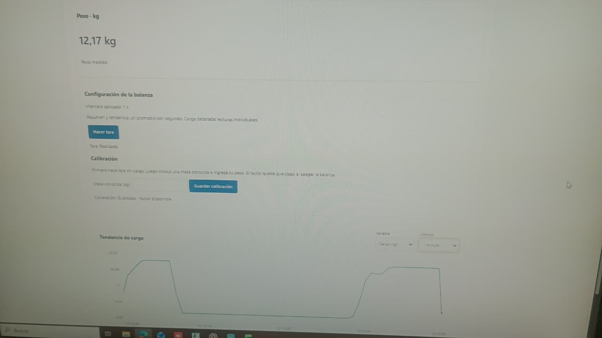
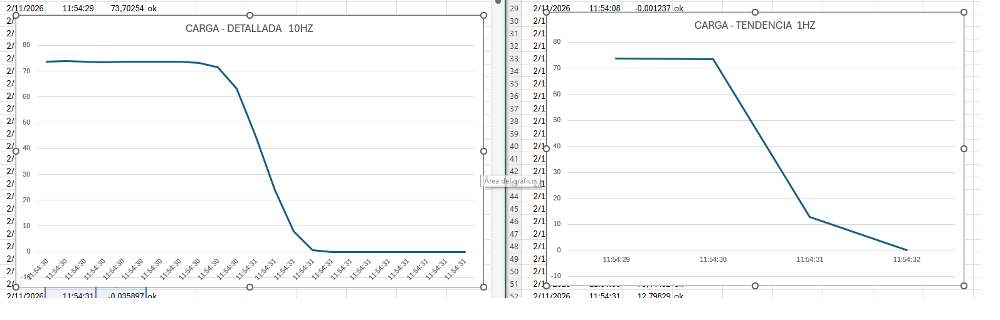
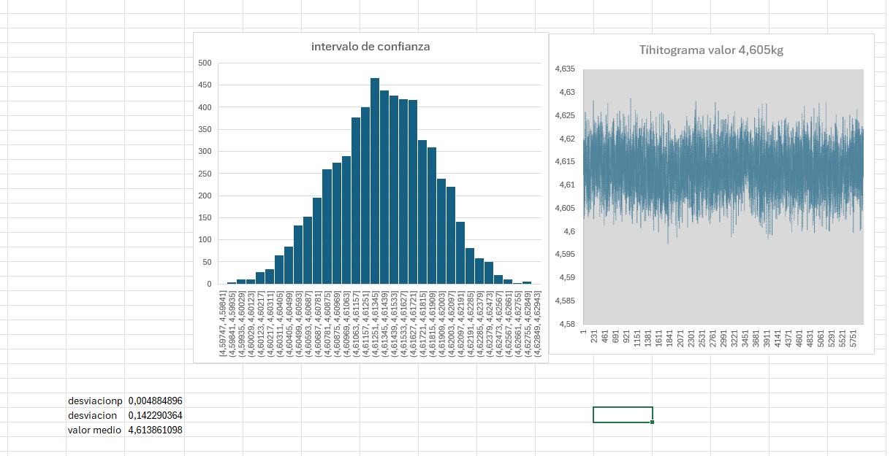
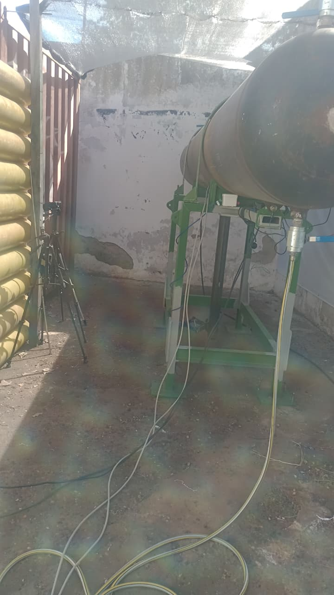
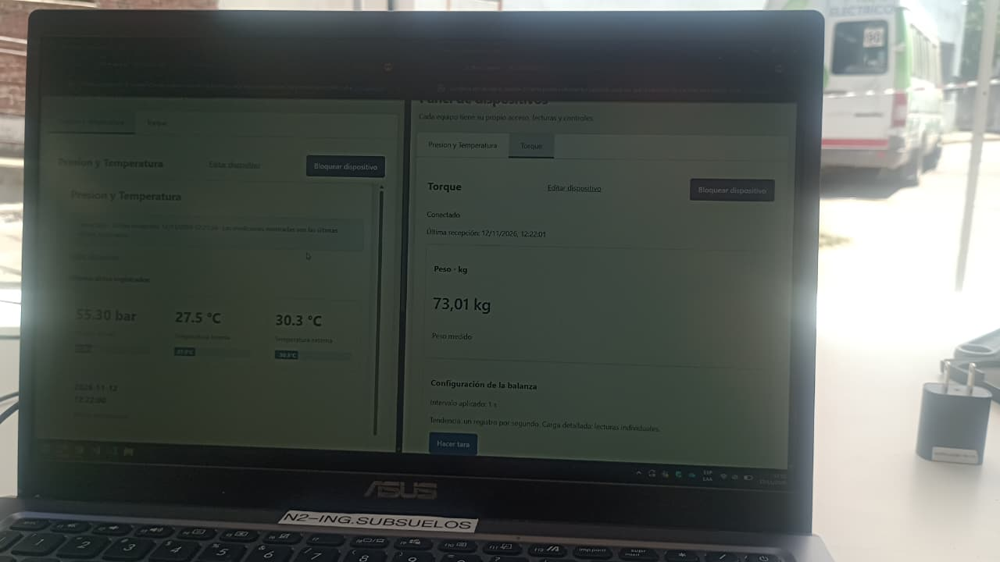

# Sistema de adquisición con celda de carga de 500 kg

**Integración de una celda comercial, acondicionamiento con HX711 y adquisición inalámbrica con ESP32.**

Proyecto de electrónica aplicada para medir carga y consultar los registros desde una interfaz web. La versión final utiliza ESP32; las versiones ESP8266 corresponden a etapas previas de desarrollo.

## Mi aporte

Integré una celda de carga comercial de capacidad nominal de 500 kg en un sistema de medición con HX711 y ESP32. El trabajo reúne adquisición de señales, integración de electrónica, configuración de tara y calibración, y comunicación con un sistema de visualización web. La celda comercial no fue diseñada ni fabricada como parte del proyecto.

## Problema y solución

El objetivo fue llevar la señal de la celda a un sistema que permitiera consultar la carga durante los ensayos y disponer de registros para su análisis. El HX711 digitaliza la señal y el ESP32 adquiere las lecturas, aplica los parámetros de ajuste y transmite datos por Wi-Fi al servidor.

## Implementación

| Elemento | Función |
| --- | --- |
| Celda de carga comercial | Conversión de la carga mecánica en señal eléctrica |
| HX711 | Digitalización de la señal de la celda |
| ESP32 | Adquisición, gestión de parámetros y comunicación |
| Wi-Fi / HTTP | Transporte de registros y consulta de órdenes |
| Interfaz web | Visualización de carga, tendencia y controles de ajuste |

El firmware ESP32 revisado separa la adquisición HX711 de las tareas de comunicación. Guarda factor y cero en NVS mediante Preferences, con una comprobación CRC. Incluye cola de registros en RAM y confirmación de lotes para gestionar reintentos.

**La versión del código inspeccionada configura detalle cada 250 ms y tendencia cada 1 s.** Es una configuración objetivo de 4 registros de detalle por segundo, no una certificación de frecuencia sostenida. El nombre del registro histórico `prueba_8hz.log` corresponde a otra prueba y no define la configuración actual.

## Evidencia del armado y uso

Las fotografías documentan el equipo armado, un montaje de ensayo y la interfaz web. El autor confirmó que la versión ESP32 quedó funcionando. No se presenta esta evidencia como una calibración certificada ni como una validación de todo el rango nominal.

## Simulaciones y análisis de datos

Captura de la carpeta de simulaciones: compara una curva rotulada como detalle a 10 Hz con una tendencia a 1 Hz. Corresponde a una etapa de estudio; no se usa para acreditar la frecuencia real de la versión final.

Histograma y serie de lecturas utilizados para explorar dispersión y estabilidad. Sin datos crudos, procedimiento de referencia y presupuesto de incertidumbre, esta captura no demuestra exactitud ni incertidumbre certificada.

## Trabajo realizado en campo

Las fotos muestran el montaje y la consulta de variables durante el trabajo real. Aunque la interfaz utiliza la etiqueta «Torque», la magnitud mostrada está en kg. Una conversión a N·m requiere documentar el brazo mecánico y la conversión de fuerza.

## Calibración y límites

- La capacidad de **500 kg pertenece a la celda comercial**. No implica que el conjunto mecánico completo esté validado para esa carga.
- La tara se realiza sin la carga de ensayo; el factor se ajusta con una masa conocida y luego debe comprobarse con otras cargas.
- Mostrar decimales en pantalla no demuestra exactitud, resolución efectiva ni incertidumbre de medición.
- La cola es volátil: un reinicio pierde los registros pendientes. Al llenarse pueden descartarse muestras; no se afirma registro sin pérdidas.
- Si el montaje se utiliza para inferir torque, hay que documentar geometría, brazo efectivo, conversión de unidades y su validación. El nombre `torque_esp32` por sí solo no acredita medición de torque.

## Estado de la documentación

Se seleccionaron las fotos para una presentación del proyecto. El firmware original está en la carpeta de trabajo local; todavía no se incluye una copia pública porque contiene configuración de conexión y debe prepararse como ejemplo sin credenciales. Tampoco se incluyen binarios de memoria, respaldos, registros internos ni versiones descartadas.

Para completar la reproducibilidad: incorporar firmware depurado, esquema de conexiones y alimentación, identificación de la celda, versiones de dependencias y resultados de calibración/repetibilidad.

## Tecnologías

ESP32 · HX711 · C/C++ · Arduino · Wi-Fi · HTTP · NVS/Preferences · Adquisición de datos · Instrumentación

**Autor:** Edimerk Adrian Torres · [LinkedIn](https://www.linkedin.com/in/edimerktorres/)

