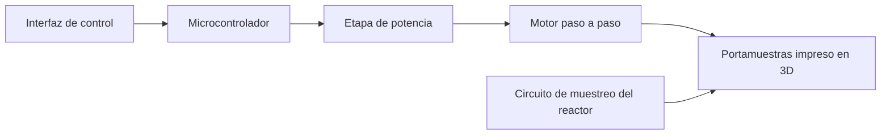
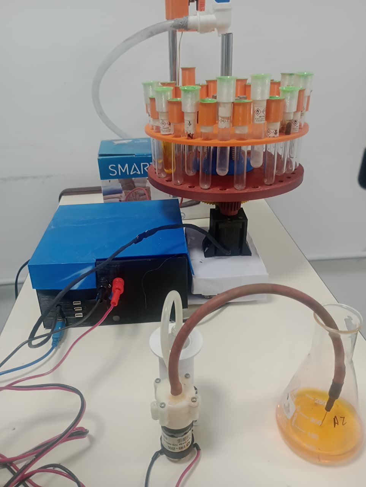
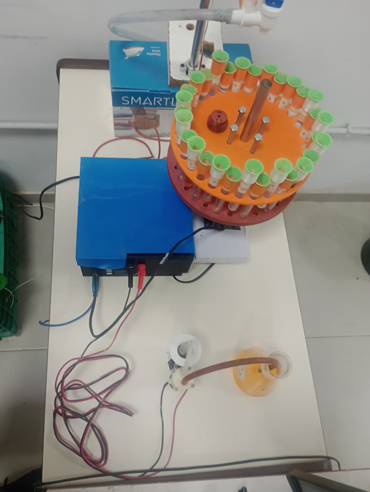
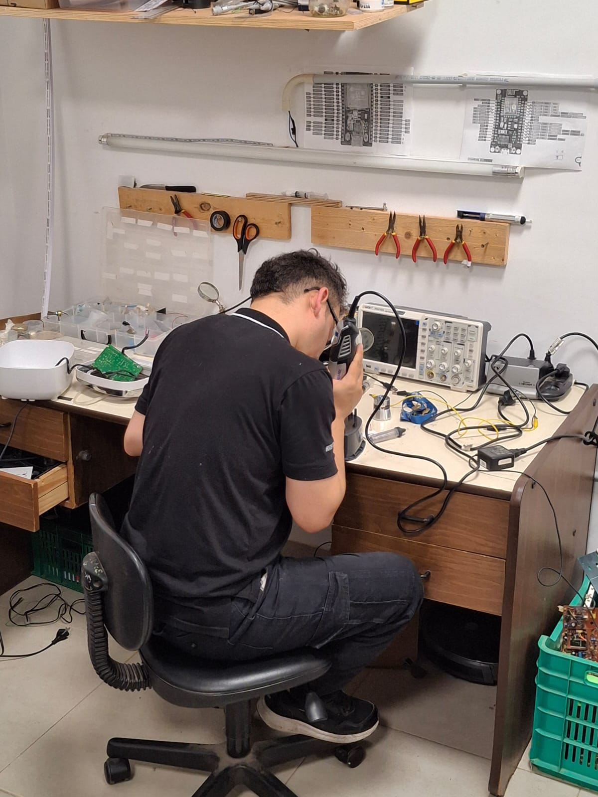

# Tomamuestras automático para reactor de aguas residuales

Diseño y construcción de un sistema de toma de muestras para un reactor de aguas residuales, con portamuestras impreso en 3D, accionamiento motorizado y control mediante microcontrolador.

**Autor: Edimerk Adrian Torres** · [LinkedIn](https://www.linkedin.com/in/edimerktorres/)

## Objetivo y aporte personal

El objetivo fue automatizar la toma de muestras de un reactor de aguas residuales. Realicé el diseño, la parte física, la electrónica y la programación. El tomamuestras se fabricó mediante impresión 3D y se integró con motor paso a paso, etapas de potencia con puente H, fuentes de alimentación y microcontroladores.

## Arquitectura funcional

## Código de referencia

- [Firmware Arduino de referencia](firmware_reactor.ino): control de motor paso a paso mediante STEP/DIR, habilitación del driver, relé, entradas por pulsos y comandos serie.
- [Interfaz Python de referencia](monitor_reactor.py): interfaz Tkinter, comunicación serie mediante pyserial y registro de datos con openpyxl.

Son dos archivos de desarrollo seleccionados de la carpeta original. No se presentan como un paquete final instalado ni se afirma que sean un par compatible sin ajustes. Antes de reutilizarlos, revisar placa, cableado, puerto serie, factores de conversión y orden de campos transmitidos. No se recompiló ni ejecutó el equipo durante esta documentación.

## Alcance

El material muestra la construcción del tomamuestras y su integración. No se declara exactitud de volumen dosificado, repetibilidad de posicionamiento ni tratamiento químico certificado: requerirían un protocolo y mediciones específicas. Se excluyó la copia del servidor de supervisión y sus configuraciones de acceso, por no ser necesarias para presentar este proyecto.

## Galería del proyecto

### Tomamuestras terminado

### Detalle del conjunto

### Trabajo de construcción y soldadura

## Videos

Videos originales del proyecto, disponibles para abrir o descargar:

- [Video 1](demostracion-1.mp4)
- [Video 2](demostracion-2.mp4)

## Tecnologías y habilidades

Impresión 3D · Motor paso a paso · Arduino · Python · Automatización
